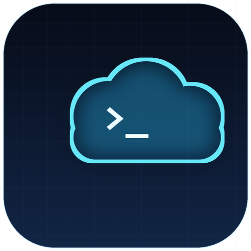

# dsh-remote-automation



English | [简体中文](README.md)

[](https://github.com/knight8818/dsh-remote-automation/actions/workflows/ci.yml)
[](LICENSE)
[](package.json)

**Run scheduled automation on remote Aliyun ECS, Tencent Cloud CVM or AWS EC2 instances from DeepSeek Harness.**

A DSH bundle that adds a **Cloud Tasks** sidebar page and a small set of agent tools. Scripts run on your own instance through the provider's zero-inbound command channel (Aliyun Cloud Assistant, Tencent Cloud TAT or AWS SSM), so the instance needs **no inbound ports** and keeps its security group closed. The local machine can be off.

> Status: Aliyun ECS, Tencent Cloud CVM and AWS EC2 (SSM) are supported. Providers live behind `lib/providers.js` + `lib/clients.js`; Azure / GCP can be added behind the same interface.

## Features

- **Dedicated page**: a `Cloud Tasks` entry under the sidebar, with provider switching, live status, run now, logs and delete.
- **Tasks remember their provider**: switching the default provider or script directory later does not move old tasks.
- **Asks every time**: creating an automation through `automation_create` always asks *cloud server* or *local DSH reminder* first. No default target.
- **Real status**, not a guess: running / idle / success / failed, last exit code, last log time, refreshed on open and while visible.
- **Zero inbound**: only outbound HTTPS (`ecs.<region>.aliyuncs.com`, `tat.tencentcloudapi.com` or `ssm.<region>.amazonaws.com`). No SSH, no open ports.
- **Secrets stay local**: nothing is bundled in this repo; credentials come from the page or environment variables, and the API only ever returns a masked AccessKey ID / SecretId.
- **Agent-friendly**: ships [`AGENTS.md`](AGENTS.md), so a DeepSeek agent that reads the repo knows exactly how to install, verify, upgrade and uninstall it.

## Requirements

| Requirement | Notes |
| --- | --- |
| DeepSeek Harness | `>= 0.2.0` (bundle patch + client plugin support) |
| Node.js | `>= 20` (host uses the standard library + official Tencent/AWS SDKs) |
| Cloud instance | Aliyun ECS (Cloud Assistant), Tencent Cloud CVM (TAT) or AWS EC2 (SSM Agent online) |
| Network | Outbound `ecs.<region>.aliyuncs.com:443`, `tat.tencentcloudapi.com:443` or `ssm.<region>.amazonaws.com:443` |
| Git | Only for installing straight from GitHub |

The plugin needs a **Web profile** (the desktop app or `dsh web`): it registers a sidebar page and an HTTP route on the `webServer` service. Headless/SDK profiles do not compose that service and will not load it.

## Installation

### 1. Let your DeepSeek install it (recommended)

Paste this to the agent in DSH, together with the repository URL:

```text
Install the DSH plugin from https://github.com/knight8818/dsh-remote-automation.
Follow the repository's AGENTS.md: install it into my desktop profile, verify the
YAML layer and node --check, do not print any file under ~/.dsh/remote-automation,
and do not restart DSH — tell me when I should fully quit and relaunch it.
```

The agent reads [`AGENTS.md`](AGENTS.md), which contains the exact `dsh plugin` command, the manual fallback, verification steps and the safety rules.

### 2. One command

Install the `dsh` CLI once (or use `npx` for a one-shot):

```bash
npm install -g @deepseek-ai/dsh
dsh plugin --profile desktop add github:knight8818/dsh-remote-automation
```

The desktop app profile is usually `desktop`; `dsh web` uses `web`. If your profile has another name, use it. On first use `dsh plugin` initializes a missing profile.

Without a global install:

```bash
npx --yes @deepseek-ai/dsh@latest plugin --profile desktop add github:knight8818/dsh-remote-automation
```

The command adds the package to the profile and appends its bundle layer automatically, because the package declares `dsh.bundle.patch`. No YAML editing, no copying files.

Verify the layer without booting:

```bash
dsh --profile desktop --dump-config | grep dsh-remote-automation
```

(PowerShell: `dsh --profile desktop --dump-config | Select-String dsh-remote-automation`.)

### 3. Manual fallback (offline / no pnpm)

```bash
git clone https://github.com/knight8818/dsh-remote-automation
# stop if the target already exists — do not nest a second copy inside it
test -e ~/.dsh/profiles/node_modules/dsh-remote-automation \
  && echo "already installed: remove or back it up first" \
  || cp -r dsh-remote-automation ~/.dsh/profiles/node_modules/dsh-remote-automation
```

Windows PowerShell:

```powershell
git clone https://github.com/knight8818/dsh-remote-automation
$dst = "$env:USERPROFILE\.dsh\profiles\node_modules\dsh-remote-automation"
if (Test-Path $dst) { throw "already installed: $dst" }
Copy-Item -Recurse .\dsh-remote-automation $dst
```

Then append to `~/.dsh/profiles/desktop/cordis.patch.yml` — only if an entry with `id: remote-automation` is not already present:

```yaml
- insert:
    - id: remote-automation
      name: dsh-remote-automation
```

On Windows the paths are `%USERPROFILE%\.dsh\profiles\node_modules\` and `%USERPROFILE%\.dsh\profiles\desktop\cordis.patch.yml`.

After either method, **fully quit DSH** (tray icon included, not just the window) and start it again. A window reload is not enough for the host part.

### Upgrading from a manual `0.1.x` install

Remove the old copy (`~/.dsh/profiles/node_modules/dsh-remote-automation`) and the three-line
`- insert:` block from the profile's `cordis.patch.yml` first, then use the one-command
install above. Keeping both registers `id: remote-automation` twice.

## Configure

Open **Cloud Tasks**, pick **Aliyun ECS** or **Tencent Cloud CVM** in the provider dropdown, click **Edit**, fill in the fields and save. The saved provider becomes the active one used by `automation_create`.

**Aliyun ECS**

| Field | Description |
| --- | --- |
| AccessKey ID / Secret | A RAM user, ideally scoped to the policy below |
| Region | e.g. `cn-shenzhen` |
| Instance ID | e.g. `i-xxxxxxxxxxxxxxxx` |

**Tencent Cloud CVM**

| Field | Description |
| --- | --- |
| SecretId / SecretKey | A CAM sub-user, ideally scoped to the policy below |
| Region | e.g. `ap-guangzhou` |
| Instance ID | e.g. `ins-xxxxxxxx` or `lhins-xxxxxxxx` (Lighthouse) |

**AWS EC2 (SSM)**

| Field | Description |
| --- | --- |
| Access Key ID / Secret Access Key | An IAM user, ideally scoped to the policy below |
| Session Token | Optional; only for temporary credentials |
| Region | e.g. `us-east-1` |
| Instance ID | e.g. `i-xxxxxxxxxxxxxxxx` |

The script directory is shared (default `/opt/automation`). Saved secrets are never sent back to the page; the field shows a placeholder and stays blank. Saving with a blank secret keeps the stored one.

Environment variables override the file:

| Provider | Variables |
| --- | --- |
| Shared | `DSH_RA_PROVIDER` (`aliyun` / `tencent` / `aws`), `DSH_RA_SERVER_DIR` |
| Aliyun | `DSH_RA_AK_ID`, `DSH_RA_AK_SECRET`, `DSH_RA_REGION`, `DSH_RA_INSTANCE_ID` (or `ALIYUN_*`) |
| Tencent | `DSH_RA_TC_SECRET_ID`, `DSH_RA_TC_SECRET_KEY`, `DSH_RA_TC_REGION`, `DSH_RA_TC_INSTANCE_ID` (or `TENCENTCLOUD_*`) |
| AWS | `DSH_RA_AWS_ACCESS_KEY_ID`, `DSH_RA_AWS_SECRET_ACCESS_KEY`, `DSH_RA_AWS_SESSION_TOKEN`, `DSH_RA_AWS_REGION`, `DSH_RA_AWS_INSTANCE_ID` (or `AWS_*`) |

The config file lives at `$DSH_HOME/remote-automation/config.json` (default `~/.dsh/remote-automation/config.json`) and is written with mode `0600` where supported. A 0.2.x flat config is read as Aliyun and upgraded to the `providers` shape on the next save.

### Aliyun RAM policy (least privilege)

Create a custom policy with exactly these actions and attach it to the RAM user:

```json
{
  "Version": "1",
  "Statement": [
    {
      "Effect": "Allow",
      "Action": [
        "ecs:RunCommand",
        "ecs:DescribeInvocationResults",
        "ecs:DescribeCloudAssistantStatus",
        "ecs:DescribeInstances",
        "ecs:InstallCloudAssistant"
      ],
      "Resource": "*"
    }
  ]
}
```

### Tencent Cloud CAM policy (least privilege)

Create a custom policy (policy syntax) with these three TAT actions and attach it to the CAM sub-user:

```json
{
  "version": "2.0",
  "statement": [
    {
      "effect": "allow",
      "action": [
        "tat:RunCommand",
        "tat:DescribeInvocationTasks",
        "tat:DescribeAutomationAgentStatus"
      ],
      "resource": ["*"]
    }
  ]
}
```

Neither policy can delete instances, change security groups, disks or networks.

### AWS IAM policy (least privilege)

Create a custom policy with these three SSM actions and attach it to the IAM user:

```json
{
  "Version": "2012-10-17",
  "Statement": [
    {
      "Effect": "Allow",
      "Action": [
        "ssm:SendCommand",
        "ssm:GetCommandInvocation",
        "ssm:DescribeInstanceInformation"
      ],
      "Resource": "*"
    }
  ]
}
```

## Usage

Say something like:

```text
Every day at 09:00, run my daily-report script on the cloud server.
```

`automation_create` asks **cloud** or **local** first. Cloud writes a script and an optional cron entry on the currently selected provider; local hands off to `schedule_*` so DSH reminds you in-session.

Tools:

| Tool | Purpose |
| --- | --- |
| `automation_create` | The only creation entry point; asks cloud vs local first, uses the active provider |
| `cloud_task_list` | List tasks across providers with live status |
| `cloud_task_run` | Trigger a task now (uses the task's provider) |
| `cloud_task_logs` | Tail the task log |
| `cloud_task_delete` | Remove script, cron entry and log |

### How status is determined

Each refresh runs a read-only script on the target instance:

| Field | Meaning |
| --- | --- |
| `running` | Whether the pid written at start is still alive (`kill -0`) |
| Last exit | Last `EXIT <code>` line in the log |
| Last log time | Log file mtime |

"Running" means the process is alive; success/failed means the latest run finished. If the process is killed with `-9`, the machine reboots, or it dies before writing `EXIT`, the badge can lag behind; check the log time. The plugin only monitors its own tasks; for arbitrary scripts, ask the agent to run `ps` / `crontab -l` on the server.

## Security model

- **No secrets in the repo or in git history.** Configuration is read from the environment or a local file written at runtime.
- The local HTTP surface (`/dsh-remote-automation/*`) requires a per-process random token injected only into the authenticated page; comparison is constant-time.
- The page receives a masked AccessKey ID / SecretId only. Secrets are never returned, logged or rendered.
- Commands run through Cloud Assistant, TAT or SSM; there is no inbound listener on the instance.
- The Tencent path uses `tencentcloud-sdk-nodejs-tat`, the AWS path uses `@aws-sdk/client-ssm`; the Aliyun path is standard-library HMAC-SHA1 only.
- Task state (`state.json`) stores the commands you asked to run, so treat it like shell history; it is written `0600`.
- The plugin sends no telemetry.

See [`SECURITY.md`](SECURITY.md) for reporting a vulnerability.

## Troubleshooting

| Symptom | Fix |
| --- | --- |
| `dsh: command not found` | Use the `npx` form, or `npm install -g @deepseek-ai/dsh` |
| Sidebar entry does not appear | Fully quit DSH including the tray process, then relaunch |
| "Plugin is not configured" | Fill the page, or set the `DSH_RA_*` variables |
| `Forbidden.RAM` | Attach the Aliyun policy above to the RAM user |
| `AuthFailure` / `UnauthorizedOperation` | Attach the CAM policy above to the Tencent sub-user |
| AWS `AccessDenied` | Attach the IAM policy above to the AWS user |
| Cloud Assistant offline | Start/install the Cloud Assistant agent on the instance |
| TAT agent offline | Install/start `tat_agent` on the CVM (public images include it) |
| SSM Agent offline | Install/start `amazon-ssm-agent` on EC2; the instance role must allow SSM |
| `id: remote-automation` appears twice | You installed both the bundle and the manual patch — remove one |
| Logs are empty right after "Run" | The process just started; refresh in a few seconds |

## Uninstall

```bash
dsh plugin --profile desktop remove dsh-remote-automation
```

For a manual install, delete `~/.dsh/profiles/node_modules/dsh-remote-automation` and remove the three-line `- insert:` block from the profile's `cordis.patch.yml`. Your credentials in `~/.dsh/remote-automation/` are kept; delete that folder yourself if you want them gone.

## Development

```bash
npm install          # test dependency yaml + Tencent TAT SDK
npm run check        # node --check on every runtime file
npm test             # node:test
```

Layout:

```
lib/host.js       host plugin: tools + HTTP routes + page token
lib/client.js     browser plugin: sidebar page (prebuilt, lazy-CJS module format)
lib/providers.js  provider metadata, field validation, masking
lib/clients.js    provider client factory
lib/aliyun.js     Aliyun Cloud Assistant RPC client (HMAC-SHA1, no SDK)
lib/tencent.js    Tencent TAT client (official SDK, RunCommand polling)
lib/aws.js        AWS SSM client (official SDK, SendCommand polling)
lib/tasks.js      task model + remote script/cron/log/status operations
lib/config.js     config resolution, v1→v2 migration, masking
lib/validate.js   input validation shared by config, tasks and HTTP
cordis.patch.yml  bundle layer (inserts the plugin row)
```

`lib/client.js` is a hand-written artifact in the DSH client module format (`window.__ModuleLoader__.load`), not a build output. The Aliyun path has no third-party runtime dependency; the Tencent / AWS paths use their official SDKs, installed automatically by `dsh plugin add` / pnpm.

## License

[MIT](LICENSE)
