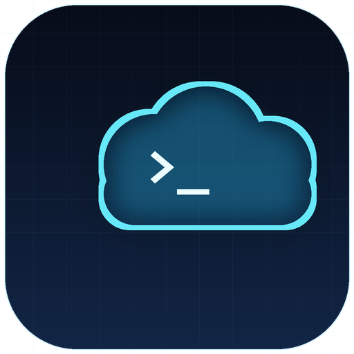

# dsh-remote-automation



[English](README.en.md) | 简体中文

[](https://github.com/knight8818/dsh-remote-automation/actions/workflows/ci.yml)
[](LICENSE)
[](package.json)

**在 DeepSeek Harness 里把定时任务放到远程云服务器上跑：阿里云 ECS、腾讯云 CVM、AWS EC2。**

给 DSH 增加一个侧栏「**云端任务**」页面和一组工具。脚本通过云厂商的零入站命令通道（阿里云 Cloud Assistant / 腾讯云 TAT / AWS SSM）在你自己的实例上执行：**不需要任何入站端口**，安全组可以一直关着，本机关机也不影响任务。

> 已支持阿里云 ECS、腾讯云 CVM、AWS EC2（SSM）。云厂商通过 `lib/providers.js` + `lib/clients.js` 抽象，Azure / GCP 可以按同一接口继续加。

## 特性

- **独立页面**：侧栏「自动化任务」下方新增「云端任务」，可切换云厂商、查看实时状态、立即运行、看日志、删除。
- **每个任务记住自己的云厂商**：之后切换默认厂商或脚本目录，老任务仍按原来的位置运行、查询、删除。
- **每次都先问**：通过 `automation_create` 创建任务时会先问「云端服务器」还是「本地 DSH 提醒」，没有默认值。
- **真实状态**：运行中 / 空闲 / 成功 / 失败、上次退出码、最近日志时间；打开即刷新，页面可见时轮询。
- **零入站**：只走出站 HTTPS（`ecs.<region>.aliyuncs.com`、`tat.tencentcloudapi.com` 或 `ssm.<region>.amazonaws.com`），不需要 SSH 或开放端口。
- **密钥不出本机**：仓库里没有任何凭证；页面只拿到打码后的 AccessKey ID / SecretId，密钥永不回传。
- **对 Agent 友好**：仓库自带 [`AGENTS.md`](AGENTS.md)，DeepSeek 读完就知道怎么安装、验证、升级和卸载。

## 环境要求

| 要求 | 说明 |
| --- | --- |
| DeepSeek Harness | `>= 0.2.0`（需要 bundle layer + 客户端插件支持） |
| Node.js | `>= 20`（宿主使用 Node 标准库 + 腾讯云 / AWS 官方 SDK） |
| 云服务器 | 阿里云 ECS（云助手在线）、腾讯云 CVM（TAT 在线）或 AWS EC2（SSM Agent 在线） |
| 网络 | 实例能出站访问 `ecs.<region>.aliyuncs.com:443`、`tat.tencentcloudapi.com:443` 或 `ssm.<region>.amazonaws.com:443` |
| Git | 仅「从 GitHub 直接安装」时需要 |

插件需要 **Web profile**（桌面版或 `dsh web`）：它要在 `webServer` 服务上注册侧栏页面和 HTTP 路由。headless / SDK profile 没有这个服务，插件不会加载。

## 安装

### 1. 让你的 DeepSeek 安装（推荐）

把下面这段和仓库链接一起发给 DSH 里的 Agent：

```text
请安装这个 DSH 插件：https://github.com/knight8818/dsh-remote-automation
按仓库里的 AGENTS.md 操作：装到我的 desktop profile，验证 YAML layer 和
node --check，不要打印 ~/.dsh/remote-automation 下的任何文件，不要重启 DSH，
装完告诉我什么时候需要完全退出再启动。
```

Agent 会读 [`AGENTS.md`](AGENTS.md)，里面有确切的 `dsh plugin` 命令、手动兜底、验证步骤和安全规则。

### 2. 一条命令

先装一次 `dsh` CLI，或者用 `npx` 一次性执行：

```bash
npm install -g @deepseek-ai/dsh
dsh plugin --profile desktop add github:knight8818/dsh-remote-automation
```

桌面版 profile 一般叫 `desktop`，`dsh web` 用 `web`；如果你的 profile 名字不同就换成实际名字。profile 不存在时 `dsh plugin` 会自动初始化。

不想全局安装：

```bash
npx --yes @deepseek-ai/dsh@latest plugin --profile desktop add github:knight8818/dsh-remote-automation
```

因为包里声明了 `dsh.bundle.patch`，这条命令会把包加进 profile，并自动把 bundle layer 追加到 `dsh.profile.bundles`。不用手改 YAML，也不用复制文件。

不启动、只验证 layer：

```bash
dsh --profile desktop --dump-config | grep dsh-remote-automation
```

### 3. 手动兜底（离线 / 没有 pnpm）

```bash
git clone https://github.com/knight8818/dsh-remote-automation
# 目标已存在就停下，不要在它里面再套一层
test -e ~/.dsh/profiles/node_modules/dsh-remote-automation \
  && echo "already installed: remove or back it up first" \
  || cp -r dsh-remote-automation ~/.dsh/profiles/node_modules/dsh-remote-automation
```

Windows PowerShell：

```powershell
git clone https://github.com/knight8818/dsh-remote-automation
$dst = "$env:USERPROFILE\.dsh\profiles\node_modules\dsh-remote-automation"
if (Test-Path $dst) { throw "already installed: $dst" }
Copy-Item -Recurse .\dsh-remote-automation $dst
```

然后在 `~/.dsh/profiles/desktop/cordis.patch.yml` 末尾追加（仅当文件里还没有 `id: remote-automation` 时）：

```yaml
- insert:
    - id: remote-automation
      name: dsh-remote-automation
```

Windows 下路径是 `%USERPROFILE%\.dsh\profiles\node_modules\` 和 `%USERPROFILE%\.dsh\profiles\desktop\cordis.patch.yml`。

无论用哪种方式，装完都要**完全退出 DSH**（托盘图标也要退出，不是只关窗口）再启动。只刷新页面不够，宿主插件需要重启才会挂载。

### 从手动安装的 `0.1.x` 升级

先删掉旧副本（`~/.dsh/profiles/node_modules/dsh-remote-automation`）和 profile 的
`cordis.patch.yml` 里那段三行 `- insert:`，再用上面的一条命令安装。两套都留着会让
`id: remote-automation` 注册两次。

## 配置

打开侧栏「云端任务」，在顶部下拉框选择 **阿里云 ECS** 或 **腾讯云 CVM**，点「编辑」填写，保存后该厂商即成为当前默认厂商。

**阿里云 ECS**

| 字段 | 说明 |
| --- | --- |
| AccessKey ID / Secret | RAM 子账号，建议只授下面的最小权限 |
| 地域 | 例如 `cn-shenzhen` |
| 实例 ID | 例如 `i-xxxxxxxxxxxxxxxx` |

**腾讯云 CVM**

| 字段 | 说明 |
| --- | --- |
| SecretId / SecretKey | CAM 子用户，建议只授下面的最小权限 |
| 地域 | 例如 `ap-guangzhou` |
| 实例 ID | 例如 `ins-xxxxxxxx` 或 `lhins-xxxxxxxx`（Lighthouse） |

**AWS EC2 (SSM)**

| 字段 | 说明 |
| --- | --- |
| Access Key ID / Secret Access Key | IAM 用户，建议只授下面的最小权限 |
| Session Token | 可选，仅临时凭证需要 |
| 地域 | 例如 `us-east-1` |
| 实例 ID | 例如 `i-xxxxxxxxxxxxxxxx` |

「脚本目录」三家共用，默认 `/opt/automation`。已保存的密钥不会回传页面，输入框显示占位符并保持为空；留空保存就沿用旧值。

环境变量优先于配置文件：

| 厂商 | 环境变量 |
| --- | --- |
| 公共 | `DSH_RA_PROVIDER`（`aliyun` / `tencent` / `aws`）、`DSH_RA_SERVER_DIR` |
| 阿里云 | `DSH_RA_AK_ID`、`DSH_RA_AK_SECRET`、`DSH_RA_REGION`、`DSH_RA_INSTANCE_ID`（也接受 `ALIYUN_*`） |
| 腾讯云 | `DSH_RA_TC_SECRET_ID`、`DSH_RA_TC_SECRET_KEY`、`DSH_RA_TC_REGION`、`DSH_RA_TC_INSTANCE_ID`（也接受 `TENCENTCLOUD_*`） |
| AWS | `DSH_RA_AWS_ACCESS_KEY_ID`、`DSH_RA_AWS_SECRET_ACCESS_KEY`、`DSH_RA_AWS_SESSION_TOKEN`、`DSH_RA_AWS_REGION`、`DSH_RA_AWS_INSTANCE_ID`（也接受 `AWS_*`） |

配置文件位于 `$DSH_HOME/remote-automation/config.json`（默认 `~/.dsh/remote-automation/config.json`），以 `0600` 权限写入。0.2.x 的扁平配置会自动按「阿里云」读取，首次保存后升级为 `providers` 结构，不需要手动迁移。

### 阿里云 RAM 最小权限

新建自定义策略，只勾下面这些动作，授权给该 RAM 用户：

```json
{
  "Version": "1",
  "Statement": [
    {
      "Effect": "Allow",
      "Action": [
        "ecs:RunCommand",
        "ecs:DescribeInvocationResults",
        "ecs:DescribeCloudAssistantStatus",
        "ecs:DescribeInstances",
        "ecs:InstallCloudAssistant",
        "ecs:SendFile",
        "ecs:DescribeSendFileResults"
      ],
      "Resource": "*"
    }
  ]
}
```

`ecs:SendFile` / `ecs:DescribeSendFileResults` 用于把脚本/小制品直接下发到实例；没有这两个权限时会自动退回 RunCommand 内联/分块，不影响大文件部署。它不能删实例、改安全组、动磁盘或网络。

### 腾讯云 CAM 最小权限

新建自定义策略（按策略语法创建），只允许 TAT 的三个动作，授权给该 CAM 子用户：

```json
{
  "version": "2.0",
  "statement": [
    {
      "effect": "allow",
      "action": [
        "tat:RunCommand",
        "tat:DescribeInvocationTasks",
        "tat:DescribeAutomationAgentStatus"
      ],
      "resource": ["*"]
    }
  ]
}
```

它同样不能删实例、改安全组、动磁盘或网络。

### AWS IAM 最小权限

新建自定义策略（JSON），只允许 SSM 的三个动作，附加给该 IAM 用户：

```json
{
  "Version": "2012-10-17",
  "Statement": [
    {
      "Effect": "Allow",
      "Action": [
        "ssm:SendCommand",
        "ssm:GetCommandInvocation",
        "ssm:DescribeInstanceInformation"
      ],
      "Resource": "*"
    }
  ]
}
```

它同样不能删实例、改安全组、动磁盘或网络。

## 使用

在对话里说：

```text
每天 9 点，在云端服务器上跑我的 daily-report 脚本。
```

`automation_create` 会先问「云端」还是「本地」。选云端 → 在页面当前选中的云厂商上生成脚本 + 可选 cron；选本地 → 转去创建 `schedule_*` 提醒。

工具：

| 工具 | 作用 |
| --- | --- |
| `automation_create` | 创建自动化任务的唯一入口，先问云端/本地，使用当前选中的云厂商；支持 `command` 内联或 `sourcePath` 制品 |
| `cloud_task_list` | 列出所有厂商的任务和实时状态（每个厂商一次查询） |
| `cloud_task_run` | 立即触发（自动使用任务所属厂商） |
| `cloud_task_logs` | 查看日志尾部 |
| `cloud_task_delete` | 删除脚本、cron 和日志 |

### 部署方式：内联 vs 制品

`automation_create` 支持两种方式：

| 方式 | 参数 | 适合 |
| --- | --- | --- |
| 内联 | `command` | 单条命令/小脚本，≤ 12 KB |
| 制品 | `sourcePath` + `entry` | 整个目录、多文件项目 |

制品流程：

1. 本地把文件/目录打成 `tar.gz`，计算 `sha256`；
2. **阿里云且制品 ≤ 24 KB**：用 `SendFile` 原生下发（需 `ecs:SendFile`）；没有权限或超过 24 KB 时自动退回分块；
3. 分块上传：阿里云 8 KB/块、腾讯云 28 KB/块、AWS 48 KB/块，4 路并发，最后 `sha256` 校验、解压到 `<脚本目录>/tasks/<任务id>/`；
4. 任务脚本 `cd` 到该目录执行 `entry`；
5. cron 之后只跑本地已解压文件，**不再需要网络下载**。

```text
把本地 C:\work\etl 部署成每天 2 点的云端任务，入口 bash run.sh
```

Agent 会调用 `automation_create({ name, sourcePath, entry, schedule })`。

限制：制品硬上限 20 MB；超过 2 MB 建议改用 OSS/COS/S3。整个方案**不需要新账号、不需要 Tailscale、不需要对象存储**，只走你已有的云助手通道；阿里云 `SendFile` 是可选的加速项。

### 状态是怎么判断的

每次查询都会在目标实例上执行一段只读脚本，返回：

| 字段 | 含义 |
| --- | --- |
| `running` | 脚本启动时写入的 pid 是否还活着（`kill -0`） |
| 上次退出码 | 日志里最后一条 `EXIT <code>`（脚本结束时写入） |
| 最近日志时间 | 日志文件的 mtime |

所以「运行中」表示进程还在；「成功 / 失败」表示最近一次运行已经结束。如果脚本被 `kill -9`、机器重启或进程在写 `EXIT` 前消失，状态可能停留在上一次结果，需要结合日志时间判断。插件只监控自己创建的任务；要检查任意脚本，可以让 Agent 在服务器上跑 `ps` / `crontab -l`。

## 安全模型

- **仓库和 git 历史里没有密钥**；配置来自环境变量或运行时写入的本机文件。
- 本机 HTTP 接口（`/dsh-remote-automation/*`）要求每个进程随机生成、仅注入已登录页面的令牌，比较使用常量时间算法。
- 页面只拿到打码的 AccessKey ID / SecretId；Secret 不回传、不写日志、不渲染。
- 命令通过云厂商的零入站通道（Cloud Assistant / TAT）下发，实例上没有新增监听端口。
- 腾讯云通道使用官方 `tencentcloud-sdk-nodejs-tat` SDK，AWS 通道使用官方 `@aws-sdk/client-ssm`；阿里云通道仍是纯标准库 HMAC-SHA1 实现。
- 制品分块只包含已打包的 tar.gz 数据，路径和任务 id 都经过校验；部署完会删除服务器上的临时压缩包。
- `state.json` 会保存你要求执行的命令，请当作 shell history 对待；写入权限 `0600`。
- 插件不上报任何遥测。

发现安全问题请看 [`SECURITY.md`](SECURITY.md)。

## 常见问题

| 现象 | 处理 |
| --- | --- |
| `dsh: command not found` | 改用 `npx` 形式，或 `npm install -g @deepseek-ai/dsh` |
| 侧栏没有「云端任务」 | 完全退出 DSH（含托盘进程）再启动 |
| 提示「插件尚未配置」 | 在页面填写，或设置 `DSH_RA_*` 环境变量 |
| `Forbidden.RAM` | 给 RAM 用户挂上面的最小权限策略 |
| `AuthFailure` / `UnauthorizedOperation` | 给 CAM 子用户挂上面的 TAT 最小权限策略 |
| AWS `AccessDenied` | 给 IAM 用户挂上面的 SSM 最小权限策略 |
| 云助手离线 | 在实例上启动/安装云助手 agent |
| TAT 自动化助手离线 | 在 CVM 上安装并启动 `tat_agent`（公共镜像默认有） |
| SSM Agent 离线 | 在 EC2 上安装并启动 `amazon-ssm-agent`，并确认实例角色允许 SSM |
| `ClientNeedUpgrade` | 云助手/TAT Agent 版本太旧；升级后会自动使用 SendFile/文件下发，否则退回内联 |
| 制品上传很慢 | 压缩后仍大于 2 MB 时建议改用 OSS/COS/S3；分块是给中小项目用的 |
| `id: remote-automation` 出现两次 | 同时用了 bundle 和手动 patch，删掉其中一个 |
| 刚点「运行」日志是空的 | 进程刚启动，过几秒刷新 |

## 卸载

```bash
dsh plugin --profile desktop remove dsh-remote-automation
```

手动安装的话，删除 `~/.dsh/profiles/node_modules/dsh-remote-automation`，并从 profile 的 `cordis.patch.yml` 里移除那段三行 `- insert:`。`~/.dsh/remote-automation/` 里的凭证会保留；要彻底清除请自行删除该目录。

## 开发

```bash
npm install          # 测试依赖 yaml + 腾讯云/AWS SDK + tar
npm run check        # 对所有运行时文件执行 node --check
npm test             # node:test
```

目录：

```
lib/host.js       宿主插件：工具 + HTTP 路由 + 页面令牌
lib/client.js     浏览器插件：侧栏页面（预构建，lazy-CJS 模块格式）
lib/providers.js  云厂商元数据、字段校验、脱敏
lib/clients.js    云厂商客户端工厂
lib/aliyun.js     阿里云 ECS 云助手 RPC 客户端（HMAC-SHA1，零 SDK）
lib/tencent.js    腾讯云 TAT 客户端（官方 SDK，RunCommand 轮询）
lib/aws.js        AWS SSM 客户端（官方 SDK，SendCommand 轮询）
lib/artifact.js   制品打包（tar.gz）、sha256、分块
lib/tasks.js      任务模型 + 制品上传/解压 + 远端脚本/cron/日志/状态操作
lib/config.js     配置读取、v1→v2 迁移与打码
lib/validate.js   配置、任务、HTTP 共用的输入校验
cordis.patch.yml  bundle layer（插入插件行）
```

`lib/client.js` 是手写产物，格式为 DSH 客户端模块的 `window.__ModuleLoader__.load`，不是构建输出。阿里云通道不依赖任何第三方运行时库；腾讯云 / AWS 通道使用官方 SDK，由 `dsh plugin add` / pnpm 自动安装。

## License

[MIT](LICENSE)
